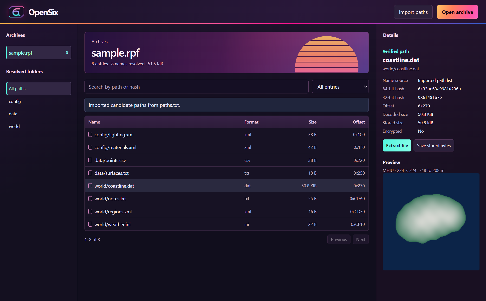
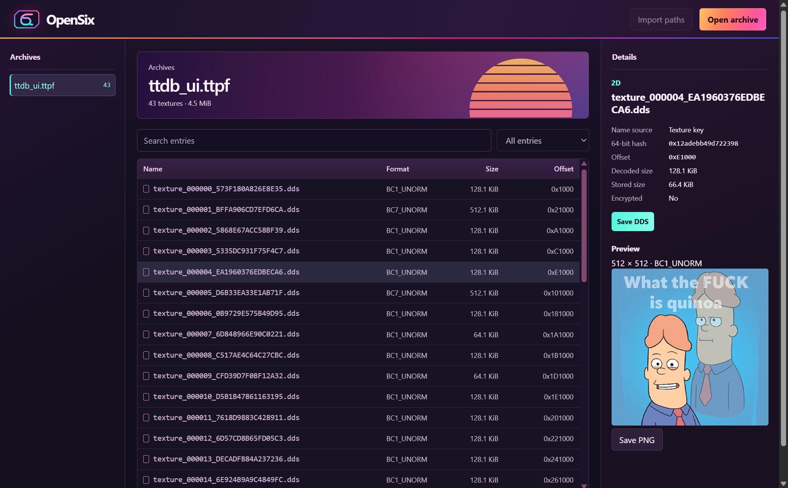

<h1> OpenSix</h1>

OpenSix is a portable Windows archive browser for GTA VI’s Scarlett build. Point it at your game folder once and it shows the full folder and archive hierarchy, searches every nested RPF9, and previews or extracts assets without launching the game. OpenSix reads your files in place.

**[Download OpenSix 1.4.0 for Windows x64](https://github.com/cyberpulse2077/OpenSix/releases/latest/download/OpenSix.exe)** · [All releases](https://github.com/cyberpulse2077/OpenSix/releases) · [How to use it](docs/usage.md) · [Supported formats](docs/compatibility.md) · [GTA VI tool audit](docs/tool-audit.md)

## What it does

- **Open your game folder once.** OpenSix finds an installed copy, remembers your choice, and opens straight into the game's folders, archives and nested archives on every later launch. Use the tree, back, forward, up and breadcrumb navigation, and right-click any entry to preview, extract, export a model or copy its path.
- **Search the whole game.** A persistent index covers every entry in every nested archive. Search file names, partial names, `*` and `?` wildcards, hashes (`hash:ab0d9aed`) and the drawable labels stored inside models, and filter by type. Results show their complete archive path. Names that match an archive hash are marked as verified or as coming from an embedded model label. Entries without a recovered name show their hash.
- **Find and export characters.** Search a name such as `lucia` or `jason` and choose **Preview and export**. OpenSix groups the character's drawables, assembles them on one skeleton with their textures, and exports GLB or FBX.
- **Browse RPF9 archives.** Open a file or scan a folder, drill into nested archives, and see entry sizes, offsets, hashes, compression, and encryption details. OpenSix checks signed headers and rejects incomplete archives.
- **Find entries by name, hash, or model label.** Import a text list of paths to resolve more names. Embedded model labels are searchable, and entries with an unresolved path are still available by hash.
- **Extract files.** Save decoded data when the storage format is supported, or save the original stored bytes. Search and batch-extract from the command line with stable entry IDs and JSON Lines reports.
- **Inspect models in 3D.** Orbit supported drawables, choose a dictionary member or fragment child, switch detail levels, and check which textures a material uses. Export GLB or binary FBX with the textures OpenSix can resolve. A textured GTA VI FBX has been checked in Blender with its geometry, UVs, and base-color texture intact.
- **Inspect collision and animation.** View supported collision bounds in 3D and export them as GLB or FBX. Browse clip dictionaries and play, pause, or scrub a supported clip on a compatible rig.
- **Assemble model parts.** Preview selected components together. Use a vehicle’s wheel bones to place wheel parts with front and rear scales, or resolve supported wardrobe kits from their catalog and open the corresponding drawables.
- **Browse textures.** Preview texture dictionaries and open TTPF pools directly. Search texture keys, select mip levels and supported array slices, cube faces, or volume slices, save PNG previews, and export DDS mip chains. The built-in VIctory decoder extends BCPack coverage when its table file is available.
- **Play audio and video.** Preview supported ADAT Opus and PCM streams, save music stems, and export XMA2 tracks. With FFmpeg, XMA2 can also play in the app. With the Bink player helper, play, pause, step through, or seek in supported Bink movies.
- **Read resource metadata.** Inspect 0DRP structures and PSIN sections, save their reports as JSON, and preview text, hex, common images, WAV and Ogg audio, and supported MHIU heightmaps.
- **Find files across open archives.** Use **Archive** to search names, hashes and indexed model labels, or export the current archive's entry index as JSON.
- **Open an interactive terrain map.** Pan and zoom a selected MHIU heightmap and inspect its world coordinates and sampled elevation. Inspect map placements and timecycle and weather XML in the same menu.
- **Work with navigation meshes.** Preview a decoded tile in 3D, isolate polygons with the road flag, and save the mesh as GLB or FBX. Export the source coordinates, vertex indices and polygon flags as JSON.
- **Inspect more resource types.** Read vehicle handling, particle rules and keyframes, groom guides, and cloth constraints. Save hair guides and cloth constraints as OBJ lines. Open a decoded audio bank or Bink movie from the **Assets** menu.
- **Search localization tables.** Search a decoded table by label hash or text and save CSV or JSON. Read typed PSIN fields and export recognized script documents as XML.
- **Inspect shader groups and Xbox GPU BVH data.** Browse decoded SGD5 members and effect links in a complete supported `shaders.rpf`. Preview the geometry for the verified Xbox GPU BVH sample and export it with its compressed BVH, geometry buffers, transforms and address descriptors.
- **Tell you about new releases.** OpenSix checks GitHub's public release list each time it starts and shows a note when a newer version exists. The request carries only the name and version of OpenSix, nothing about you or your game. It never installs anything by itself, and the check can be switched off in **About**.
- **Create unsigned RPF9 archives.** Pack a folder of files, then reopen it with the original relative paths in OpenSix.
- **Convert assets for GTA V mods.** Save YMAP placements, YDR drawables, YBN collision files, YTD textures, and YTYP archetypes from supported inputs.
- **Play Bink 2 video and export audio.** Step and seek with the built-in decoder, and save supported DCT tracks as WAV.

## Getting started

1. Run `OpenSix.exe`. It opens as a desktop app and needs no installer.
2. On the first launch, choose your game folder from the detected list or with **Browse**. It is the folder that contains `game_scarlett_master.exe`. OpenSix remembers it and builds a search index in the background. You can browse right away.
3. Browse the tree, search the whole game, select an entry to preview it, or right-click for extraction and export. **Archive → Open other RPF9** still opens a file from outside the game folder.

Bring your own game files. OpenSix includes the VIctory decoder. To enable it for more textures, place its table file next to the EXE. The [usage guide](docs/usage.md) has the download link and explains how to add optional Bink and XMA2 playback.

## Inside the texture viewer

The diner scene above and the “What the fuck is quinoa” image below are 512 × 512 textures decoded from GTA VI’s `ttdb_ui.ttpf` pool.

## Compatibility

OpenSix supports one GTA VI Xbox Series X|S (Scarlett) build. The [compatibility notes](docs/compatibility.md) give the executable fingerprint, supported formats, and known limits. Source archives open read-only. Some names, models, materials, and storage formats remain unresolved.

## Source and credits

See the [Windows build instructions](docs/build.md) and [contribution notes](CONTRIBUTING.md). The native tools use [SixNG](https://github.com/holdmysocks/SixNG), [rpf9-explorer](https://github.com/breadbbbb/rpf9-explorer), [VIctory](https://github.com/Marvisak/VIctory), and [Assimp](https://github.com/assimp/assimp). The app uses [Electron](https://www.electronjs.org/) and [Three.js](https://threejs.org/). The archive workflow takes its cues from [OpenIV](https://openiv.com/).

## License

I make the original OpenSix desktop app available for free noncommercial use under the [OpenSix Noncommercial License](LICENSE). Contact me for uses that need permission under those terms. The release includes the corresponding source for the GPLv3 preview and texture-pool components. See [component licenses](docs/build.md#component-licenses).

OpenSix is an independent project. Grand Theft Auto and Rockstar Games are marks of their respective owners.
