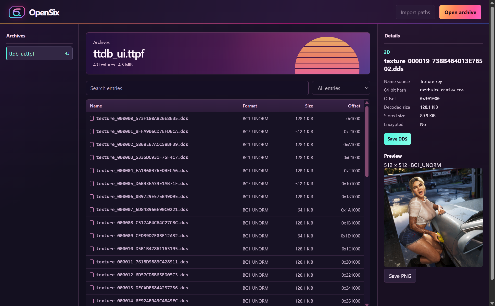

# Using OpenSix

## Top menus

Use **Archive** to open files, import paths, search open archives, and export the selected archive index. When a complete supported `shaders.rpf` is selected, **Export shader index** writes the decoded records and their searchable names and links.

**World**, **Assets**, and **Data** open separate tool dialogs. Select a file in the archive browser first and choose **Use selected entry**, or use **Open decoded file** to work with an extracted resource. For a resource with separate system and graphics pages, use the corresponding archive entry so OpenSix can read the layout from its directory record.

- **World** opens terrain, placement, navigation and timecycle tools. Navigation tiles can be filtered to road polygons and exported as GLB, FBX or JSON.
- **Assets** opens handling, groom, cloth and particle reports, plus audio-bank and movie playback. Bink and XMA2 playback use the helpers documented below.
- **Data** opens the localization search, typed PSIN inspection and script XML extraction. Localization CSV preserves game text and quotes spreadsheet formula prefixes as literal text.

Download [OpenSix.exe](https://github.com/cyberpulse2077/OpenSix/releases/latest/download/OpenSix.exe) and run it on Windows x64. Choose the executable and archive from the supported Scarlett build. OpenSix reads the executable to get the archive format tables, and the game stays closed.

## Archives and filenames

**Open archive** takes an RPF9 file or a local folder. Select an archive in the sidebar, then select an entry to see its size, offset, hashes, and available preview. Use **Open nested archive** to go deeper. OpenSix rejects incomplete archives.

Use **Import paths** with one candidate path per line. A matching path appears as a verified name. Use **Index model labels** to make the drawable names stored inside models searchable. A model label can describe the asset even when its original archive path is unknown.

**Extract file** saves decoded data. **Save stored bytes** keeps the entry as it was stored in the archive.

## Models and animation

Open a drawable, fragment, or dictionary, then choose a drawable and detail level when the asset offers them. Drag to orbit and scroll to zoom. **Material and texture sources** shows the resolved texture references and any gaps. Save GLB or FBX from the preview.

For animation, open a clip dictionary and select **Use clip on a model**. Open a model with compatible bones and use the playback controls to inspect the motion. The preview reports how many bone tracks it mapped.

To combine parts, add each model in **Model assembly** and choose **Preview assembly**. For wheels, add the vehicle body first. Enter front and rear scales and add each wheel component. Open a supported wardrobe catalog and choose **Assemble wardrobe kit** when its drawable archives are open. The kit’s JSON report includes its texture and palette references.

## TTPF texture pools

Select **Open texture pool** and choose a complete `.ttpf` file. Search by key, format, or name. Choose a mip and, for supported layouts, an array slice, cube face, or volume slice. **Save DDS** keeps the chain starting at the first available source mip. When you preview a lower mip, **Save DDS from mip** exports the chain starting there. A PNG export saves the displayed image.



The portable EXE includes VIctory’s BCPack decoder. To use it on more textures, [download the matching table file](https://github.com/Marvisak/VIctory/raw/d2a4bae1f49533ef5cb512fd1b1ba1513f2e1989/crates/victory-formats/src/bcpack-tables.bin), save it as `bcpack-tables.bin` beside `OpenSix.exe`, and open the pool as usual. OpenSix picks up the file automatically. When a source mip is unavailable, OpenSix can preview a lower mip it can verify.

## Audio and video

Select a track in a supported audio bank to listen or save it. Opus, PCM, and music stems play in the app. XMA2 can be saved as a track. For XMA2 playback, make [FFmpeg](https://ffmpeg.org/) available on `PATH` or set `OPENSIX_FFMPEG` to its absolute path.

For supported Bink movies, use the `Tools/bink-player.exe` from the [rpf9-explorer v1.3 release](https://github.com/breadbbbb/rpf9-explorer/releases/tag/v1.3). Place it beside OpenSix.exe or set `OPENSIX_BINK_PLAYER` to its absolute path. OpenSix checks that it has the expected helper before starting playback.

## Batch workflows

Use `--report` with a new local file to get JSON Lines from the portable executable. Search gives you the entry ID to use for an export. `--recursive` includes nested archives, `--labels` indexes embedded model labels, and `--names` imports a path list. Leave out `--exe` for a TTPF.

```powershell
.\OpenSix.exe --cli search 'C:\Game\data.rpf' --exe 'C:\Game\game_scarlett_master.exe' --recursive --query zft --report 'C:\Exports\search.jsonl'
.\OpenSix.exe --cli export 'C:\Game\data.rpf' --exe 'C:\Game\game_scarlett_master.exe' --recursive --id '<entry-id>' --out 'C:\Exports\Models' --report 'C:\Exports\export.jsonl'
```

Add `--stored` to export the stored representation of an archive entry. Pass `--id` more than once to extract a batch.
